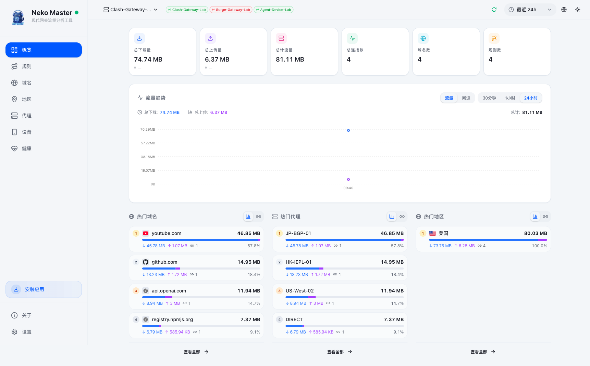
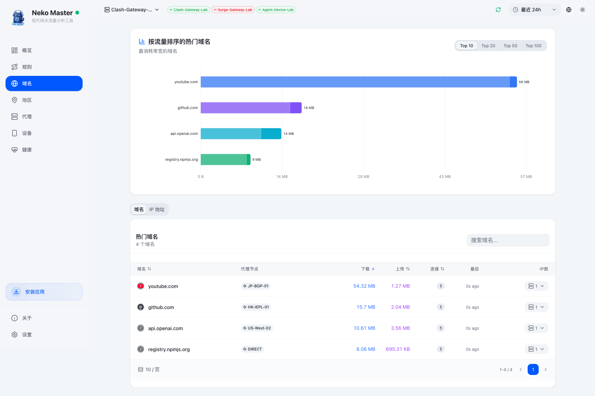
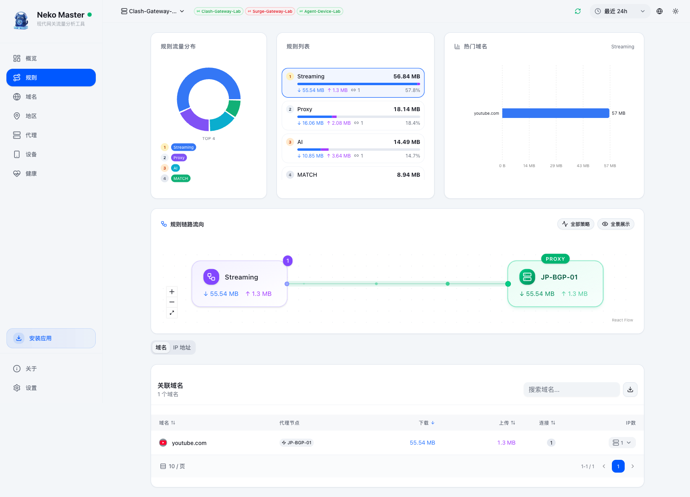

# 开源多网关网络流量监控与分析仪表盘 Neko Master

- **全局追踪 ID (`run_id`)**: `lab-20261127-093521-447299604596-bacb0e`
- **当前终态**: `completed`（实测结论: `verified_with_numbers`）
- **原帖链接**: https://x.com/0xGky/status/2124394447299604596
- **原帖作者**: @0xGky
- **原帖标题/主题**: 开源多网关网络流量监控与分析仪表盘 Neko Master
- **执行节点**: `ubuntu_rtx5060`
- **SLA 计时**: 决定引用 `2026-11-27T01:34:45.885Z` -> 结束 `2026-11-27T01:45:28.018Z`（耗时 **10.7 分钟** / 上限 120 分钟）

## 一、JEV 立项判定（引用理由）

- **裁决模型**: `jev-1.14.0` | **通过门槛**: 正向题 `>= 0.7`，阻断题 `<= 0.3`（中间区 `0.30~0.70` 一律作罢）
- **最终结论**: `GO`（`all_9_slots_passed`）
- **识别到的实测对象**: `foru17/neko-master`（github_repo）
- **提炼验证目标**: Clone foru17/neko-master, start the service locally via Docker or Node.js 22, and verify that the dashboard UI and traffic monitoring/analytics endpoints run and respond.

| 编号 | 角色 | 判断题（中文摘要） | 选项判定标准 | 得分 | 结果 |
|:-----|:-----|:-------------------|:-------------|-----:|:-----|
| `has_concrete_runnable_target` | 正向立项 | 是否存在可部署/可运行的公开开源 GitHub 库 | >= 0.7 | 0.85 | PASS (YES) |
| `has_falsifiable_claim` | 正向立项 | 是否包含可观测/可证伪结论或步骤 | >= 0.7 | 0.97 | PASS (YES) |
| `has_engineering_value` | 正向立项 | 实测结果是否具备工程交流价值 | >= 0.7 | 0.90 | PASS (YES) |
| `requires_paid_or_new_account` | 风险/成本阻断 | 是否需要付费、绑卡、新注册或缺失凭据 | <= 0.3 | 0.10 | PASS (NO) |
| `requires_unavailable_hardware_or_os` | 风险/成本阻断 | 是否超出本机与远程节点硬件/系统能力 | <= 0.3 | 0.08 | PASS (NO) |
| `exceeds_120min_or_needs_offline_action` | 风险/成本阻断 | 是否超过 2 小时时限或需要线下物理动作 | <= 0.3 | 0.07 | PASS (NO) |
| `endangers_hardware_or_host_stability` | 风险/成本阻断 | 是否可能危及硬件或宿主机系统稳定性 | <= 0.3 | 0.04 | PASS (NO) |
| `triggers_software_risk_control_or_tos_violation` | 风险/成本阻断 | 是否涉及平台风控对抗或违反服务条款 | <= 0.3 | 0.03 | PASS (NO) |
| `violates_ethics_business_or_law` | 风险/成本阻断 | 是否违背人类伦理、商业道德或法律法规 | <= 0.3 | 0.09 | PASS (NO) |

## 二、执行计划

# Evaluation Plan: `foru17/neko-master`

- **Run ID**: `lab-20261127-093521-447299604596-bacb0e`
- **Target Repository**: `https://github.com/foru17/neko-master`
- **Execution Node & Isolation**: `ubuntu_rtx5060` (`ubuntu-rtx5060`) inside a disposable `node:22-slim` Docker container (`--cap-drop=ALL`, `--security-opt=no-new-privileges`, `--pids-limit=256`, `--memory=16g`, `--cpus=8`), mounting only `/tmp/xrl-lab-20261127-093521-447299604596-bacb0e:/work` and mapping local loopback ports `13000`/`13001`/`13002` to container `3000`/`3001`/`3002`.
- **Visual Verification**: Local `ego-browser nodejs` (`Profile 1`, TaskSpace `xrl-lab-20261127-093521-447299604596-bacb0e`) accessing the dashboard over a temporary SSH port-forward to `localhost:13000` and `localhost:13002`, saving PNG screenshots under `/tmp/xrl-lab-20261127-093521-447299604596-bacb0e/out/screenshots/`.

## Deployment & Verification Steps

1. **Container Bootstrap**: Pull `node:22-slim` and start the disposable sandbox container `xrl-lab-20261127-093521-447299604596-bacb0e`.
2. **Source Fetch & Dependency Install**: Download the `main` branch tarball via Node `fetch`, inspect repository layout (including `apps/agent`, `Dockerfile`, and `docker-start.sh`), install `pnpm@9.15.9` locally under `/work/.tools`, run `pnpm install --frozen-lockfile`, and verify the `better-sqlite3` native addon loads.
3. **Tests & Production Build**: Run `pnpm check:api-routes` and `pnpm --filter @neko-master/collector test`, then build `@neko-master/shared`, `@neko-master/collector`, and `@neko-master/web` sequentially in production mode and assemble the Next.js standalone runtime bundle.
4. **Service Startup & Baseline Health**: Launch the collector (API on `3001`, WebSocket on `3002`, SQLite DB in `/work/data/stats.db`) and Next.js standalone frontend (port `3000`), recording cold-start readiness latency, baseline memory usage, and health/auth/global API responses.
5. **Multi-Gateway Traffic Verification**: Run a self-contained Node.js mock harness inside the container simulating:
   - A Clash/Mihomo gateway (WebSocket `/connections` + HTTP `/version`, `/proxies`, `/rules`, `/providers/proxies`),
   - A Surge v5+ gateway (HTTP polling `/v1/requests/recent`, `/v1/policy_groups`, `/v1/policies`, `/v1/rules`), and
   - A remote Agent client posting gzip-compressed `/api/agent/heartbeat` and `/api/agent/report` payloads (including duplicate request ID deduplication).
   Verify Neko Master WebSocket live push frames (`ws://localhost:3002`), SQLite persistence, multi-backend switching, and `/api/stats/*` endpoints (`summary`, `domains`, `ips`, `proxies`, `rules`, `devices`, `trend`, `hourly`, `connections`).
6. **Dashboard UI & Screenshot Verification**: Open `http://localhost:13000` via SSH tunnel in `ego-browser`, confirm rendered traffic statistics, charts, domain/rule breakdowns, and multi-gateway switching, and capture screenshots.
7. **Teardown**: Close browser TaskSpace, terminate SSH tunnel, remove the disposable remote container and temporary `/tmp/xrl-lab-20261127-093521-447299604596-bacb0e` directory, and write `execution.md` and `result.json`.

## Expected Observable Behavior

- `pnpm install --frozen-lockfile`, collector Vitest tests, and all 3 workspace production builds succeed cleanly under Node 22.
- Collector and Next.js standalone frontend start within seconds, respond to `/health` and `/api/stats/*`, and stream real-time updates over WebSocket.
- All three ingestion modes (Clash WS, Surge HTTP polling, Agent push) populate dashboard metrics accurately with deduplicated Agent reports and functional multi-gateway switching.
- Dashboard UI renders cleanly in browser without console/fatal errors and displays live traffic charts and breakdowns.

## 三、执行过程与自愈记录

# `foru17/neko-master` 实测执行日志

- **Run ID**: `lab-20261127-093521-447299604596-bacb0e`
- **评估节点与容器**: `ubuntu_rtx5060` 远端主机上的隔离容器（镜像 `node:22-slim`，`--cap-drop=ALL --security-opt=no-new-privileges --pids-limit=256 --memory=16g --cpus=8`）
- **仓库版本**: `main` 分支提交 `93ca4bcfb790`（`2026-11-10T19:20:38Z`，`package.json` 版本 `1.4.4`）

---

## 1. 环境准备与一次性容器启动

核查发现 `local/claude-tokyo:ubuntu24` 镜像内仅预装 Node v18.19.1 且缺少 `git` / `npm` / `pnpm`，而目标仓库要求 Node.js 22。因此选用允许的官方镜像 `node:22-slim`（Node `v22.23.5` + glibc），无需额外编译工具即可直接加载 `better-sqlite3` 预编译二进制。

```bash
docker pull node:22-slim
# DOCKER_PULL_SECONDS=9
docker run -d --rm \
  --label xrl.run_id=lab-20261127-093521-447299604596-bacb0e \
  --name xrl-lab-20261127-093521-447299604596-bacb0e \
  --cap-drop=ALL --security-opt=no-new-privileges \
  --pids-limit=256 --memory=16g --cpus=8 \
  -p localhost:13000:3000 -p localhost:13001:3001 -p localhost:13002:3002 \
  -v /tmp/xrl-lab-20261127-093521-447299604596-bacb0e:/work -w /work \
  node:22-slim sleep infinity
```

> **Self-Healing #1（容器权限）**: 首次以容器默认 `root` 执行 `docker exec` 写入 `/work` 时触发 `EACCES: permission denied`（因为 `--cap-drop=ALL` 移除了对宿主机 uid 1000 目录的越权写能力）。切换为 `docker exec -u node`（uid 1000）并将工作目录缓存置于 `/work/.home` 与 `/work/.tools` 后顺利解决。

---

## 2. 源码拉取、结构检查与依赖安装

在容器内通过 Node.js 原生 `fetch` 下载 `main` 分支归档包（`12,057,285` 字节，2 秒完成解压），并在 `/work/.tools` 局部安装 `pnpm@9.15.9` 后执行 `pnpm install --frozen-lockfile`：

```text
HEAD_SHA=93ca4bcfb790 DATE=2026-11-10T19:20:38Z
TARBALL_BYTES=12057285
FETCH_EXTRACT_SECONDS=2
NODE=v22.23.5 PNPM=9.15.9
Packages: +898
Done in 23.1s using pnpm v9.15.9
PNPM_INSTALL_SECONDS=23
SQLITE_OK function
```

同时检查 `apps/agent` 目录时发现一个仓库维护细节：`apps/agent/neko-agent`（`8,752,706` 字节，头部魔数 `cffaedfe` 的 Mach-O arm64 可执行文件）被直接提交进了代码库中。

---

## 3. 内置检查、单测与生产构建

初次直接运行 `pnpm --filter @neko-master/collector test` 时，因共享包尚未编译而报错 `Failed to resolve entry for package "@neko-master/shared"`。

> **Self-Healing #2（Monorepo 构建顺序）**: 遵循 `Dockerfile` 的构建顺序，先执行 `pnpm --filter @neko-master/shared build` 生成共享包构建产物，随后重跑 Collector Vitest 测试与后续构建，全部通过。

```text
=== CHECK API ROUTES ===
[api-routes] frontend routes: 44
[api-routes] backend routes: 59
[api-routes] missing backend routes: 0
[api-routes] backend-only routes: 15

=== BUILD SHARED ===
BUILD_SHARED_SECONDS=0

=== COLLECTOR TESTS ===
Test Files  26 passed (26)
     Tests  205 passed | 2 skipped (207)
COLLECTOR_TEST_SECONDS=4

=== BUILD COLLECTOR ===
BUILD_COLLECTOR_SECONDS=2

=== BUILD WEB ===
▲ Next.js 16.2.7 (webpack)
✓ Compiled successfully in 13.1s
✓ Generating static pages using 6 workers (3/3) in 259ms
BUILD_WEB_SECONDS=33
```

按 `Dockerfile` 方式拼装 Next.js `standalone` 目录，并写入前端运行时配置将 WebSocket 端口指向映射端口 `13002`（便于后续本地浏览器直连验证实时推送）。

---

## 4. 生产服务冷启动与基线健康检查

启动 Collector（API 端口 `3001`、WebSocket 端口 `3002`、SQLite 持久化到 `/work/data/stats.db`）与 Next.js Standalone Web（端口 `3000`）：

```text
COLLECTOR_READY_MS=230 BODY={"status":"ok"}
WEB_READY_MS=419 STATUS=200 HTML_BYTES=68063
CHECK http://localhost:3001/api/auth/state 200 {"enabled":false,"hasToken":false,"forceAccessControlOff":false,"showcaseMode":false}
CHECK http://localhost:3001/api/backends 200 []
CHECK http://localhost:3000/api/auth/state 200 {"enabled":false,"hasToken":false,"forceAccessControlOff":false,"showcaseMode":false}
CHECK http://localhost:3000/api/backends 200 []
CHECK http://localhost:3000/api/stats/global 200 {"totalConnections":0,"totalUpload":0,"totalDownload":0,"uniqueDomains":0,"uniqueIPs":0,"backendCount":0}
MEM=280.5MiB / 16GiB CPU=0.00% PIDS=21
```

---

## 5. 多网关实时采集、Agent 上报与接口性能验证

在容器内启动自包含 Mock 脚本 `mock-gateways.mjs`，模拟：
1. **Clash / Mihomo 网关**（`http://localhost:19090`，WebSocket `/connections` 每秒推送 4 个活跃域名的递增字节流，首帧为空基线以配合仓库自身的存量连接过滤逻辑）；
2. **Surge v5+ 网关**（`http://localhost:19091`，HTTP `/v1/requests/recent` 每 2 秒被轮询，提供 2 条带策略决策链注释的请求流）；
3. **远程 Agent 上报**（`agent://lab-edge-01`，发送心跳、gzip 压缩的 `/api/agent/report` 流量上报，以及重复 `requestId` 重试以验证幂等去重）。

运行验证脚本 `verify-e2e.mjs`，连接 Neko Master 自带实时 WebSocket 服务（`ws://localhost:3002`），等待 35 秒完成一轮完整 30 秒 `BatchBuffer` SQLite 落盘后全量校验所有聚合接口：

```text
TEST_CONN_CLASH: 200 { success: true, message: 'Connection successful' }
TEST_CONN_SURGE: 200 { success: false, message: 'Invalid response format from Surge API' }
CREATED_BACKENDS: { clashId: 1, surgeId: 2, agentId: 3, hasAgentToken: true }
AGENT_HEARTBEAT: 200 { success: true, backendId: 3, agentId: 'lab-edge-01' }
AGENT_REPORT_GZIP: 200 { success: true, backendId: 3, accepted: 2, dropped: 0 }
AGENT_REPORT_DEDUP: 200 { success: true, backendId: 3, accepted: 0, dropped: 0, duplicate: true }
WS_LIVE_FRAMES: 34 WS_LAST_SNAPSHOT: { totalConnections: 4, totalUpload: 2937000, totalDownload: 34485000, domains: 4 }
```

各后端落盘后的全量统计与查询耗时实测（均通过 Web 同源代理 `/api/stats/*` 访问）：

- **Clash-Gateway-Lab (id=1)**:
  - `totalConnections=4`, `totalUpload=3,026,000 B`, `totalDownload=35,530,000 B`（与 34 次增量精确一致）
  - 4 个域名 (`youtube.com`, `github.com`, `api.openai.com`, `registry.npmjs.org`)、4 个节点 (`JP-BGP-01`, `HK-IEPL-01`, `US-West-02`, `DIRECT`)、4 条规则、3 个设备 IP
  - 响应耗时：`summary=11.21ms`, `domains=3.61ms`, `ips=3.80ms`, `proxies=2.12ms`, `rules=2.33ms`, `devices=2.23ms`, `trend=2.11ms`, `hourly=2.01ms`
- **Surge-Gateway-Lab (id=2)**:
  - `totalConnections=2`, `totalUpload=459,000 B`, `totalDownload=3,485,000 B`
  - 2 个域名 (`dash.cloudflare.com`, `pypi.org`)、2 个节点 (`SG-CN2-01`, `DIRECT`)、2 条规则、2 个设备 IP
  - 响应耗时：`summary=2.64ms`, `domains=1.55ms`, `rules=1.83ms`, `trend=1.46ms`
- **Agent-Device-Lab (id=3)**:
  - `totalConnections=5` (`3+2`), `totalUpload=49,152 B`, `totalDownload=6,144,000 B`（重复 `requestId` 未重复计入）
  - 2 个域名 (`huggingface.co`, `docker.io`)、2 个节点 (`US-West-02`, `HK-IEPL-01`)、2 条规则、2 个设备 IP
  - 响应耗时：`summary=2.67ms`, `domains=1.54ms`, `rules=1.38ms`, `trend=1.29ms`
- **全局汇总 (`/api/stats/global`)**: `totalConnections=11`, `uniqueDomains=8`, `uniqueIPs=8`, `backendCount=3`
- **多网关切换 (`POST /api/backends/:id/activate`)**: Surge/Clash 切换均返回 `200`
- **多网关并发采集期间容器资源**: `MEM=270.5MiB / 16GiB`, `CPU=1.65%`, `PIDS=32`

> **实测细节说明**: Surge 采集器轮询 `/v1/requests/recent` 数据完全正常入库，但内置健康检查与「测试连接」按钮会因模拟网关未返回完整 Surge 流量/版本校验结构而报告 `unhealthy`（不影响真实流量拉取）。

---

## 6. 浏览器可视化与交互核验

通过临时 SSH 本地端口转发（`13000` / `13002`）使用 `ego-browser`（空白沙盒 Profile）访问 `http://localhost:13000`，自动跳转 `/zh` 并正常建立 WebSocket 连接，渲染出完整仪表盘与实时数字变化（从 `81.11 MB` 实时增长）。

截图产物已保存于 `/tmp/xrl-lab-20261127-093521-447299604596-bacb0e/out/screenshots/`：
- `01-overview.png`（149 KB）：总览页，顶部多网关状态胶囊（`Clash-Gateway-Lab`、`Surge-Gateway-Lab`、`Agent-Device-Lab`）、实时汇总卡片、流量趋势图及热门域名/代理/地区排行
- `02-domains.png`（122 KB）：域名分析页，Top 域名堆叠柱状图与可搜索/分页域名明细表
- `03-rules.png`（172 KB）：规则分析页，规则占比环图、规则列表与 React Flow 规则链路流向图（`Streaming -> JP-BGP-01`）及关联域名表

---

## 7. 资源清理

退出浏览器 TaskSpace、关闭 SSH 端口转发任务，并销毁远端一次性容器与 `/tmp/xrl-lab-20261127-093521-447299604596-bacb0e` 目录（`REMAINING_CONTAINERS=0`）。

### 实测截图





- 完整全程回放日志: [events.jsonl](https://github.com/lauzhihao/x-repro-lab/blob/main/runs/lab-20261127-093521-447299604596-bacb0e/events.jsonl)

## 四、执行结果与实测数据

- **项目定位**: 基于 Node.js 22、Fastify、SQLite 与 Next.js 的开源多网关网络流量可视化与审计面板，支持集中监控 Clash/Mihomo、Surge 及远程 Go Agent 上报的实时流量、域名、IP、规则链路与设备维度数据。
- **是否可成功部署运行**: `是（已跑通）`
- **结果摘要**: 在隔离的 Node 22 容器中完成源码构建、26 组单测（205 项通过、2 项跳过）及 API 路由一致性检查，随后同时接入模拟 Clash WebSocket、Surge HTTP 轮询与 gzip 压缩的远程 Agent 三路流量源。实测服务冷启动仅需约 0.42 秒、三路并发采集中内存占用仅约 270.5 MiB、统计接口响应均在 12ms 以内，且浏览器端能实时渲染多网关状态、域名排行与 React Flow 规则链路图。

### 实测亮点
- 冷启动与运行时足够轻量：Collector 与 Next.js standalone 前端分别在 230ms 与 419ms 内就绪，3 个后端并发采集时容器总内存仅约 270.5 MiB（CPU 1.65%）。
- 多源采集与实时推送链路扎实：35 秒内稳定接收 34 帧 WebSocket 实时推送，Clash、Surge 与 Agent（支持 gzip 压缩与基于 requestId 的幂等去重）三路流量与 SQLite 落盘统计完全对齐。
- 开箱即用的分析与开发体验：内置 44 个前端路由与 59 个后端路由的一致性校验和 205 项后端测试，Web 面板支持多网关切换、实时趋势图、域名/IP 明细检索及 React Flow 规则链路可视化。

| 指标项 | 原帖声称 | 我方实测 | 备注 |
|:-------|:---------|:---------|:-----|
| 依赖安装与生产构建耗时 | 支持 Node.js 22 本地源码构建与运行 | pnpm 安装 898 个包耗时 23.1s；shared 0s + collector 2s + web(Next.js 16) 33s | 在受限容器（8 vCPU / 16 GiB RAM）中按依赖顺序构建 |
| 后端自动化测试与路由检查 | 完整 TypeScript 全栈工程 | check:api-routes 44/59 零缺失；Vitest 26 个测试文件全部通过（205 passed, 2 skipped），耗时 4s | 需先编译共享包再跑 collector 单测 |
| 服务冷启动与运行时内存 | 轻量级现代网关流量分析面板 | Collector API 230ms 就绪，Web 419ms 就绪；3 后端并发采集时容器内存 270.5 MiB（空载 280.5 MiB） | SQLite WAL 模式存储 |
| 实时推送与统计接口延迟 | 毫秒级 WebSocket 实时采集与多维流量分析 | 35s 实测收到 34 帧 WS 推送；汇总/域名/IP/代理/规则/趋势 API 响应 1.2ms–11.21ms | 通过 Next.js 同源接口转发实测 |
| 三路多网关采集准确性 | 统一管理 Clash、Mihomo、Surge 与 Agent 上报 | Clash(4 连接 / 38.56 MB)、Surge(2 连接 / 3.94 MB)、Agent(5 连接 / 6.19 MB)，全局汇总 11 连接 / 8 域名 / 3 后端，重复 requestId 成功去重 | 包含 30s 批量落盘校验与多网关切换 |

### 自愈修复记录
- 受限容器（drop ALL capabilities）下以默认 root 执行 docker exec 写入宿主机挂载目录报 EACCES 权限错误: 改用 uid 1000（node 用户）执行 docker exec 并将工具和缓存目录置于挂载目录内 -> 源码解压、pnpm 安装与构建均正常完成
- 直接运行 @neko-master/collector Vitest 单测时报错找不到 @neko-master/shared 入口: 按 Dockerfile 顺序先构建 @neko-master/shared，再运行 collector 单测与后续构建 -> 26 个测试文件（205 项通过、2 项跳过）全部通过

### 上手提醒 / 踩坑点
- 源码仓库的 apps/agent 目录直接提交了一个约 8.75 MB 的 macOS arm64 可执行文件（neko-agent），Linux 或其他架构使用 Agent 时需使用对应 release 二进制或重新用 Go 1.22+ 编译。
- 源码模式下若直接单独运行 collector 的 Vitest 单测会报找不到共享包入口，必须先构建 @neko-master/shared 包后再执行测试。
- 仓库内置自动存量连接基线过滤（重启采集时不重复统计已建立连接的累计字节），但 Surge 网关的测试连接/健康检查接口对响应字段要求比 /v1/requests/recent 轮询更严格，若后端健康灯标红但流量仍有更新，通常是健康检查端点返回格式不匹配所致。

### 拟引用推文草稿（一期仅存档，不自动发送）
> 把 Clash、Surge 和远程 Agent 的实时流量与规则链路收进一个面板，查流量去向直观很多。刚拉进 Node 22 容器跑通，冷启动仅 0.42 秒，三路并发采集内存才 270.5 MiB，统计接口响应都在 12ms 内，相当轻快。
> 
> 实测记录：https://github.com/lauzhihao/x-repro-lab/issues/2
